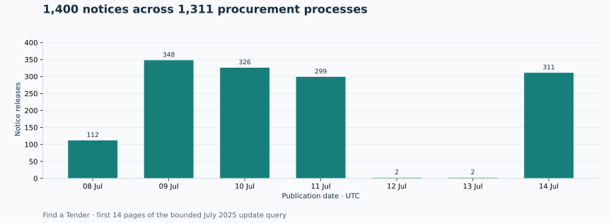

# UK procurement dashboard

A local dashboard for **1,400 Find a Tender notice releases across 1,311 procurement processes**. Filter publication dates and notice tags, then inspect which releases for a process were public at a chosen time.

The importer commits one API page at a time. A recovery check kills it halfway through page eight, restarts it, and compares the finished database with a clean import.



## Open the dashboard

Download or clone this repository and open [`results/dashboard.html`](results/dashboard.html) in a browser. It is self-contained and works offline. Click a chart label to filter the sample; use **Clear filters** to reset it. **Load a sample process** opens a process with more than one notice.

## Rebuild

Python 3.12; the importer and exporter use the standard library only.

```sh
python -m procurement.index
python -m procurement.dashboard
python -m procurement.verify
python -m unittest procurement.test_index -v
```

To run the browser check:

```sh
python -m pip install -r requirements-browser.txt
python -m playwright install chromium
python -m unittest procurement.test_dashboard -v
```

Run commands from the repository root. The 14 cached metadata pages are included. `python -m procurement.fetch` can fetch the bounded API window again.

## What is checked

| Check | Result |
|---|---:|
| Cached pages | 14 |
| Unique notice releases | 1,400 |
| Procurement processes | 1,311 |
| Processes with several releases | 76 |
| Historical publication cutoffs checked | 165 |
| Committed pages skipped after restart | 7 |
| Recovered database vs clean import | Same row checksum |

Repeated pages are skipped. Overlapping pages use `(ocid, id)` as the release key. If the same cursor or release identity returns changed content, the page transaction rolls back. These checks protect the stored history.

Publication times are normalised to UTC before comparison. A cutoff includes releases published exactly at that time. History includes every indexed release up to the cutoff; it does not merge their fields into a complete procurement record. The charts count releases, and one release can have several tags.

The browser check compares chart totals and filters with SQLite, tests a historical cutoff and checks the layout at a 390-pixel viewport.

## Files and data

- `procurement/index.py`: SQLite schema, page transactions, history queries and importer CLI.
- `procurement/verify.py`: crash recovery, reverse replay and historical-cutoff checks.
- `procurement/dashboard.py`, `procurement/web/dashboard.html`: HTML exporter and interface.
- `data/tender_index/`: original API URLs and the four indexed fields: `ocid`, `id`, `date`, `tag`.
- `results/metrics.json`: verified counts and database checksum.

The API query covers updates from 1–15 July 2025, limited to its first 14 pages. Publication dates can fall outside that update window. The sample is bounded and does not represent the whole UK procurement market.

Sources: [Find a Tender](https://www.find-tender.service.gov.uk/), [Cabinet Office open contracting](https://www.gov.uk/government/publications/open-contracting), [OCDS releases and records](https://standard.open-contracting.org/latest/en/primer/releases_and_records/).


To redraw the saved figure, install `requirements-plots.txt` and run `python -m procurement.plot`.
